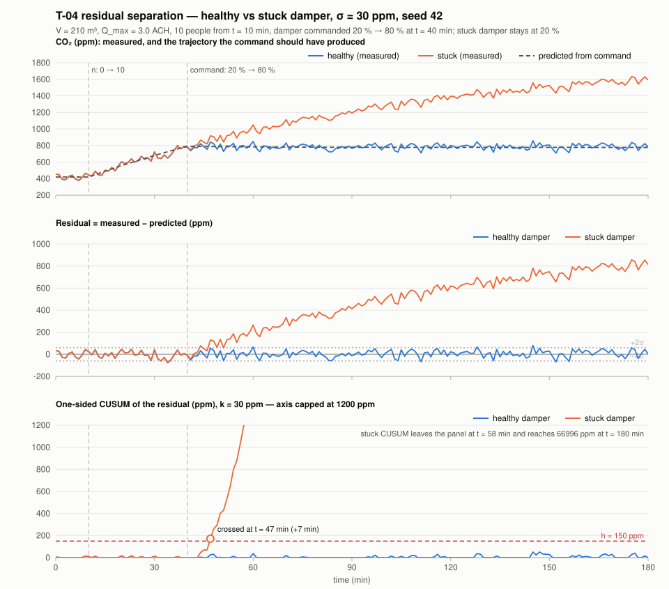

# T-04 — Offline single-zone spike: residual with a healthy vs a stuck damper

**Question.** Does a residual between the CO₂ a damper command *should* have produced and the
CO₂ actually measured separate a stuck damper from a busy room, at realistic sensor noise
(σ ≈ 30 ppm)? This is the kill criterion of the plan (PLAN-A06-implementation.md §5 P1, R-1).

**Separable at σ=30 ppm: yes**

## Reproduce

```sh
cd project/spikes/residual-separation && java Main.java
```

Plain Java 25 (OpenJDK 25.0.3), no build tool, no dependencies, no preview flags. The run takes
about a second and (re)writes `healthy.csv`, `stuck.csv` and `plot.svg` next to the code. All
randomness is seeded, so the files and the numbers below are reproducible bit for bit.

## What was simulated

One well-mixed room, CO₂ mass balance `V·dC/dt = n·G + Q·(C_out − C)`, integrated with forward
Euler at 1 s and sampled every 60 s over 180 simulated minutes.

| Parameter | Value | Note |
|---|---|---|
| V | 210 m³ | a plausible level-0 room, 70 m² × 3 m |
| G | 0.005 L/s per person = 5·10⁻⁶ m³/s | multiplied by 10⁶ so that the balance is in ppm: 5.0 ppm·m³/s per person |
| C_out | 420 ppm | outdoor air, also the initial room level |
| Q | position × Q_max, Q_max = 0.175 m³/s | 3.0 ACH at 100 %; 20 % → 0.6 ACH, 80 % → 2.4 ACH |
| Occupancy n | 0 → 10 people at t = 10 min | step |
| Damper command | 20 % → 80 % at t = 40 min | step |
| Healthy damper | actual position = commanded | |
| Stuck damper | actual position stays at 20 % | the command is ignored |
| Sensor noise | Gaussian, σ = 30 ppm, seed 42 | same seed for both runs, so both runs see the same noise sequence |
| Steady state with 10 people | 1849 ppm at 20 %, 777 ppm at 80 % | sanity check of the parameters |

**Observer.** The prediction is the same model driven by the *commanded* position, and it uses
the **true occupancy n**. That is a deliberate simplification for this spike: the real observer
will not have n (the plan's risk register and proposal §6 both say so; T-11 has to work from
commanded step responses instead). Consequently the healthy residual here is pure sensor noise
with no model error — the spike measures separation under noise, not under model mismatch.

**Residual and CUSUM.** residual = measured − predicted. One-sided upper CUSUM
S₀ = 0, Sₜ = max(0, Sₜ₋₁ + rₜ − k), alarm when Sₜ ≥ h, with

- **k = 30 ppm = 1.0 σ** — the reference value is set to σ because a stuck damper produces a
  large, growing bias (hundreds of ppm), not a subtle shift; k = σ makes the statistic insensitive
  to noise and to small model errors.
- **h = 150 ppm = 5.0 σ** — chosen from R-3 (≤ 1 false alarm per simulated week = 10 080 samples
  at 60 s). Siegmund's approximation gives ARL₀ ≈ 1.1·10⁵ samples ≈ 79 days for (k, h) = (1σ, 5σ),
  i.e. ≈ 0.1 false alarms per week, an order of magnitude inside R-3. h = 4σ would give ARL₀ ≈
  1.5·10⁴ samples ≈ 10 days, which is marginal. A 2000-run Monte Carlo on i.i.d. Gaussian noise
  reproduced ARL₀ ≈ 1.1·10⁵ for the pair used.

## Results

Seed 42, both runs:

| Run | mean residual | std | min | max | mean residual after the command | max CUSUM | CUSUM crossing of h |
|---|---|---|---|---|---|---|---|
| healthy | 3.5 ppm | 31.8 ppm | −76.5 ppm | 80.3 ppm | 5.3 ppm | 50.3 ppm | none |
| stuck | 392.1 ppm | 297.6 ppm | −76.5 ppm | 856.2 ppm | 507.8 ppm | 66 996 ppm | **t = 47 min, 7 min after the ignored command** |

Separation of the post-command mean residual: **16.7 σ**. The healthy residual's standard
deviation (31.8 ppm) confirms that the injected noise is what reaches the residual.

**False-alarm check** — healthy damper, 20 seeds (1..20): **0 of 20** crossed h = 150 ppm. Peak
CUSUM per seed: median 51.0 ppm, max 149.1 ppm (seed 14). That one peak sits just under h;
it is a single tail draw (the next-highest seed peaks at 91.6 ppm) and consistent with the
Monte-Carlo probability of about 3 % that at least one of 20 three-hour healthy runs crosses 5σ.
It is reported as it is; h is swept properly in T-24.

**Detection check** — stuck damper, the same 20 seeds: **20 of 20** crossed h; delay after the
ignored command min / median / max = **5 / 8 / 11 min**, against R-1's p95 ≤ 15 min.

**Threshold sensitivity** on the same runs (the CUSUM statistic depends on k only, so h can be
evaluated after the fact):

| h | healthy false alarms | stuck detected | stuck delay median / max |
|---|---|---|---|
| 120 ppm (4σ) | 1 / 20 | 20 / 20 | 7 / 10 min |
| **150 ppm (5σ), used** | **0 / 20** | **20 / 20** | **8 / 11 min** |
| 180 ppm (6σ) | 0 / 20 | 20 / 20 | 9 / 11 min |
| 240 ppm (8σ) | 0 / 20 | 20 / 20 | 9 / 12 min |

Raising h from 5σ to 8σ costs about one minute of detection delay; lowering it to 4σ already
produces a false alarm in 20 short runs. The trade-off is flat on the detection side because the
stuck-damper residual grows without bound while the command stays ignored.

## Plot



Top: measured CO₂ for both runs and the trajectory the command should have produced (identical
for both runs). Middle: the two residual series with the ±2σ noise band. Bottom: the one-sided
CUSUM with h; the stuck curve leaves the capped axis at 58 min and reaches 66 996 ppm at 180 min.

## Verdict

**Separable at σ=30 ppm: yes.** Rule applied: every stuck run crosses h and no healthy run
crosses h, over seed 42 plus 20 check seeds. The kill criterion does not fire; P2 can start.

## Program output

```text
T-04 residual-separation spike — one well-mixed room, healthy vs stuck damper
Model      V·dC/dt = n·G + Q·(C_out − C), forward Euler at 1 s
Room       V = 210 m³, C_out = 420 ppm, G = 5.0e-06 m³/s per person (0.005 L/s → ×10⁶ gives 5.0 ppm·m³/s)
Airflow    Q = position × Q_max, Q_max = 0.175 m³/s = 3.0 ACH; 20 % → 0.60 ACH, 80 % → 2.40 ACH
Steady     10 people: 1849 ppm at 20 %, 777 ppm at 80 %
Scenario   n: 0 → 10 at t = 10 min; damper command 20 % → 80 % at t = 40 min; horizon 180 min; sample every 60 s
Observer   same model, commanded position, true n (simplification — the real observer will not have n)
Noise      Gaussian σ = 30 ppm on the measurement, seed 42 for both runs
CUSUM      one-sided, k = 30 ppm (1.0 σ), h = 150 ppm (5.0 σ); Siegmund ARL₀ ≈ 1.1e+05 samples ≈ 79 days at 60 s

Run (seed 42)   mean r    std r    min r    max r   mean r after cmd   max CUSUM   crossing
healthy            3.5     31.8    -76.5     80.3                5.3        50.3   no crossing
stuck            392.1    297.6    -76.5    856.2              507.8     66996.4   t = 47 min (7 min after the ignored command)
Separation of the post-command mean residual: 16.7 σ

False-alarm check   healthy damper, seeds 1..20: 0 of 20 crossed h = 150 ppm; peak CUSUM per seed median 51.0 ppm, max 149.1 ppm (seed 14)
Detection check     stuck damper, seeds 1..20: 20 of 20 crossed h; delay after the ignored command min/median/max = 5/8/11 min

Threshold sensitivity on the same 20 seeds (the CUSUM statistic depends on k only, so h is evaluated after the fact):
  h = 120 ppm (4 σ): healthy false alarms 1/20, stuck detected 20/20, stuck delay median/max 7/10 min
  h = 150 ppm (5 σ): healthy false alarms 0/20, stuck detected 20/20, stuck delay median/max 8/11 min  <- used
  h = 180 ppm (6 σ): healthy false alarms 0/20, stuck detected 20/20, stuck delay median/max 9/11 min
  h = 240 ppm (8 σ): healthy false alarms 0/20, stuck detected 20/20, stuck delay median/max 9/12 min

Verdict rule: every stuck run crosses h, no healthy run crosses h
Separable at σ=30 ppm: yes
```

## Files

| File | Content |
|---|---|
| `Main.java` | scenario, stdout, CSV and plot writing, verdict |
| `ZoneSimulation.java` | room model, scenario steps, damper behaviour, CUSUM, one run |
| `SvgPlot.java` | hand-written SVG renderer (no library) |
| `healthy.csv`, `stuck.csv` | one row per 60 s sample: `t` (s), `n`, `commanded`, `actual` (damper position 0..1), `C_true`, `C_measured`, `C_predicted`, `residual`, `cusum` (all ppm) |
| `plot.svg` | the plot above |

## Caveats

- The observer knows n. Without it, the healthy residual carries an occupancy-shaped bias and the
  separation shrinks; T-11 has to show that judging commanded step responses is enough.
- Truth and observer share the same model, so there is no model error in the healthy residual.
  Real model error adds a slow bias that k has to absorb; that is what T-05 (noise sensitivity)
  and T-24 (h sweep) should quantify.
- The fault model is invented (a damper frozen at its last position), as the proposal says.
- Forward Euler at 1 s against time constants of 25 min (80 %) and 100 min (20 %) is accurate to
  well under 1 ppm; the sampling, not the integration, is the limiting factor.

**T-05 (noise sensitivity: smallest detectable damper deviation vs σ) was not measured.** It
was to be appended here, and it is not: this spike sweeps `h` at one σ and one damper
deviation, so nothing in it answers the question. The gap is stated here rather than left as a
promise, and the consequence for the result above is the record of what it costs: the 16.7 σ
separation is a statement about the one injected deviation at σ = 30 ppm, not a detection limit.
